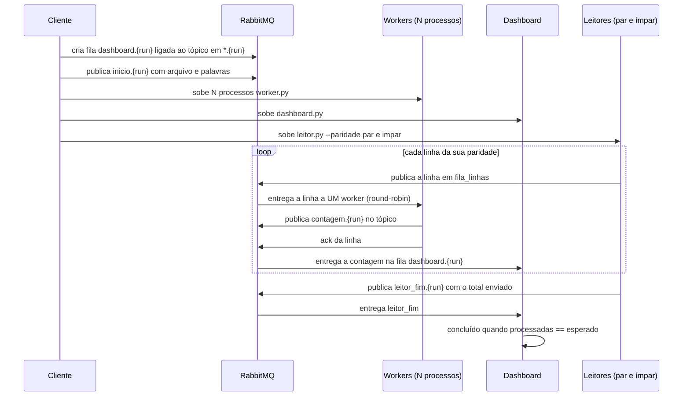

# Projeto MOM — Contagem paralela de palavras-chave

Workflow de computação paralela com **MOM (RabbitMQ)** em Python: dois leitores de linha
(pares/ímpares) alimentam uma **fila**; N workers consomem a fila, contam as palavras-chave e
publicam o resultado num **tópico**; o dashboard assina o tópico e atualiza os totais em tempo real.

## Como rodar

```bash
# 1) broker (precisa do Docker)
docker compose up -d

# 2) dependências (uma vez)
python3 -m venv .venv && ./.venv/bin/pip install -r requirements.txt   # tkinter vem com o Python (Ubuntu: sudo apt install python3-tk)

# 3) arquivo de teste (opcional) e aplicação
./.venv/bin/python scripts/gerar_arquivo.py 200000 data/entrada.txt
./.venv/bin/python src/cliente.py            # interface gráfica
```

### Ativando a venv (opcional)

Os comandos acima chamam `./.venv/bin/python` direto e funcionam sem ativar nada. Se preferir
digitar só `python`, ative a venv uma vez por terminal:

```bash
source .venv/bin/activate      # Linux/macOS (o prompt passa a mostrar "(.venv)")
# .venv\Scripts\activate       # Windows

python scripts/gerar_arquivo.py 200000 data/entrada.txt
python src/cliente.py

deactivate                     # para sair da venv
```

Sem interface (útil para testar): `python src/cliente.py --cli -a data/entrada.txt -p python,java,erro -w 3`.
Painel do broker: http://localhost:15672 (guest/guest). Outro host: variável `RABBITMQ_HOST`.

## Arquitetura (numeração do diagrama do enunciado)

| # | Componente | Arquivo | Papel no MOM |
|---|---|---|---|
| 1 | Cliente | `src/cliente.py` | pede arquivo/palavras, sobe workers, dashboard e os 2 leitores |
| 2 | Leitor de linhas (par e ímpar) | `src/leitor.py` | **Produtor** da fila |
| 3 | Fila de linhas | `fila_linhas` (RabbitMQ) | fila durável, entrega round-robin |
| 4 | Contador de palavras (workers) | `src/worker.py` | **Consumidor** da fila + **Publisher** do tópico |
| 5 | Tópico de palavras | exchange `topico_palavras` (tipo *topic*) | publish/subscribe |
| 6 | Dashboard | `src/dashboard.py` | **Subscriber** do tópico |

`src/config.py` concentra a conexão e a topologia; `scripts/gerar_arquivo.py` cria o arquivo de teste.

### Fluxo de mensagens

1. Cliente cria a fila `dashboard.<run>` já ligada ao tópico (`*.<run>`) e publica `inicio.<run>`
   (arquivo + palavras). Isso vem *antes* dos leitores porque o tópico não guarda mensagens:
   sem a fila pré-criada, o dashboard poderia perder as primeiras contagens.
2. Cada leitor lê o arquivo em streaming, e para cada linha da sua paridade publica
   `{run_id, linha, texto, palavras}` em `fila_linhas`. Linhas numeradas a partir de 1
   (ímpar = 1, 3, 5…; par = 2, 4, 6…).
3. Os workers (competing consumers) pegam linhas da fila, contam cada palavra-chave
   (palavra inteira, sem diferenciar maiúsculas/minúsculas), publicam `contagem.<run>` com
   `{linha, contagem, worker}` e só então dão **ack**. Se um worker morrer antes do ack, a
   linha volta para a fila e outro a processa (entrega *at-least-once*).
4. Ao terminar, cada leitor publica `leitor_fim.<run>` com quantas linhas enviou. O dashboard soma
   os dois totais e sabe que acabou quando `linhas processadas == linhas enviadas`.
5. O dashboard soma as contagens, mostra barras por palavra, progresso, linhas/s e quantas linhas
   cada worker processou (evidência do paralelismo).

### Decisões de projeto (para a explicação do código)

- **Por que fila e tópico?** A fila distribui *trabalho* (cada linha vai para **um** worker); o
  tópico distribui *informação* (todo assinante interessado recebe). É a diferença entre os dois
  modelos de MOM pedidos no enunciado.
- **Mensagens persistentes + fila durável** e **ack manual** garantem que nenhuma linha se perde.
- **`prefetch`=100** nos workers: cada um recebe um lote de linhas por vez, em vez de uma ida ao
  broker por linha.
- **Threads no dashboard:** o pika `BlockingConnection` não é thread-safe; só a thread assinante
  fala com o broker e entrega os dados à interface (tkinter) por uma `queue.Queue`.
- **Isolamento por `run_id`:** resultados de execuções antigas não se misturam com a atual.

### Limitações conhecidas

- Com entrega *at-least-once*, uma falha de worker entre publicar e dar ack pode contar uma linha
  duas vezes (raro; dedupe por número de linha exigiria guardar todos os números no dashboard).
- Palavras são comparadas literalmente: "ação" ≠ "acao".

---

## Perguntas da apresentação

Respostas às quatro perguntas, com link para a linha exata do código. Antes delas, dois conceitos
que aparecem em todas as respostas: MOM e GIL.

### Contexto: o que é MOM

**MOM (Message-Oriented Middleware)** é um software intermediário que permite a programas trocarem
**mensagens** sem falar diretamente uns com os outros. Em vez de o programa A chamar o programa B, A
entrega a mensagem a um **broker** (o "carteiro"), e o broker a entrega a quem tiver interesse.

Isso traz três tipos de **desacoplamento**:

| Desacoplamento | O que significa | No projeto |
|---|---|---|
| **Espaço** | quem envia não sabe quem recebe, nem onde ele está | o leitor não sabe quantos workers existem nem quais são |
| **Tempo** | quem envia e quem recebe não precisam estar ativos ao mesmo tempo, porque a fila guarda a mensagem | as linhas ficam na `fila_linhas` até algum worker pegar |
| **Sincronização** | quem envia não fica esperando a resposta | o leitor publica e já segue para a próxima linha |

O MOM tem **dois modelos** de comunicação, e o projeto usa os dois:

| Modelo | Como funciona | No projeto |
|---|---|---|
| **Ponto a ponto (fila)** | cada mensagem é entregue a **um único** consumidor. Com vários consumidores na mesma fila, o broker reparte as mensagens entre eles | `fila_linhas`: cada linha vai para **um** worker. É assim que o trabalho é dividido |
| **Publish/subscribe (tópico)** | a mensagem é entregue a **todos** os assinantes interessados | `topico_palavras`: os resultados vão para quem assinou, no caso o dashboard |

**Peças usadas neste projeto:**

- **RabbitMQ** é o broker, ou seja, o MOM de fato. Ele roda no Docker
  ([docker-compose.yml](docker-compose.yml)).
- **AMQP** é o protocolo de rede que o RabbitMQ fala.
- **pika** é a biblioteca Python que fala AMQP. Ela é só o *cliente* do broker.
- **Exchange** é o lugar onde se publica no RabbitMQ. Ninguém publica direto numa fila: a exchange
  recebe a mensagem e a encaminha para as filas segundo a *routing key*.
  - **Exchange padrão (`""`)** entrega direto na fila cujo nome é igual à routing key. É o que o
    leitor usa para mandar linhas para a `fila_linhas`.
  - **Exchange do tipo topic** entrega para as filas cujo padrão casa com a routing key (`*` casa
    exatamente uma palavra). A fila `dashboard.ab12` está ligada a `*.ab12`, então recebe
    `contagem.ab12`, `inicio.ab12` e `leitor_fim.ab12`.
- **Ack** é a confirmação de que o consumidor terminou de processar. Enquanto não chega o ack, o
  broker guarda a mensagem. Se o consumidor morrer antes de confirmar, o broker a entrega a outro.

### Contexto: o que é GIL

O **GIL (Global Interpreter Lock)** é uma trava do CPython (o Python "normal") que permite que
**apenas uma thread por processo execute código Python de cada vez**. Mesmo numa máquina com 8
núcleos, 8 threads Python que fazem cálculo se revezam num núcleo só. A troca entre elas é tão
rápida que parece paralelo, mas não é.

O GIL **é liberado** quando a thread fica esperando I/O (rede, disco, `time.sleep`). Por isso:

| Tipo de tarefa | Threads ajudam? | Por quê |
|---|---|---|
| **I/O-bound** (esperar rede ou disco) | **Sim** | enquanto uma thread espera, ela solta o GIL e outra roda |
| **CPU-bound** (calcular, aplicar regex) | **Não** | só uma thread por vez segura o GIL |

**Como isso decide a arquitetura do projeto:**

- **Contar palavras** (aplicar regex em cada linha) é trabalho de **CPU**. Com threads, os workers se
  revezariam no GIL e não haveria ganho. Por isso cada worker é um **processo** separado
  (`subprocess.Popen`). Cada processo tem o próprio interpretador e o próprio GIL, e o sistema
  operacional os roda em núcleos diferentes ao mesmo tempo.
- Isso combina com o MOM. Como os workers só se comunicam pelo broker, poderiam até rodar em
  **máquinas diferentes**, bastando apontar `RABBITMQ_HOST` para o broker.
- **No dashboard as threads não servem para ganhar velocidade.** Elas existem porque há **dois laços
  que bloqueiam para sempre**: o `start_consuming()` do pika (espera mensagens da rede) e o
  `mainloop()` do tkinter (espera eventos da janela). Cada laço precisa da sua própria thread. Como
  a thread do pika passa quase todo o tempo esperando a rede, ela solta o GIL e não atrapalha a
  interface.

> Observação: o Python 3.13 trouxe uma versão experimental *free-threaded*, sem GIL (PEP 703), que
> precisa ser instalada à parte. O Python padrão, usado aqui, continua com GIL.

### 1. Mostre a sequência de execução

**Resposta curta:** o cliente prepara o broker e sobe os processos nesta ordem: fila do dashboard,
aviso `inicio`, workers, dashboard e leitores. Os leitores enviam as linhas para a fila. Os workers
contam e publicam no tópico. O dashboard soma tudo e para quando `processadas == esperado`.



Onde cada passo está no código:

| # | Passo | Código |
|---|---|---|
| 1 | Valida entrada e gera o `run_id` | [cliente.py#L45-L51](src/cliente.py#L45-L51) |
| 2 | Conecta e cria a fila `dashboard.<run>` ligada ao tópico | [cliente.py#L54-L61](src/cliente.py#L54-L61) → [config.py#L54-L66](src/config.py#L54-L66) |
| 3 | Publica `inicio.<run>` | [cliente.py#L62-L63](src/cliente.py#L62-L63) |
| 4 | Sobe os workers (processos) | [cliente.py#L68](src/cliente.py#L68) → [cliente.py#L37-L41](src/cliente.py#L37-L41) |
| 5 | Sobe o dashboard (processo) | [cliente.py#L72-L73](src/cliente.py#L72-L73) |
| 6 | Sobe os 2 leitores (processos) | [cliente.py#L77-L83](src/cliente.py#L77-L83) |
| 7 | Leitor lê linha a linha e filtra a paridade | [leitor.py#L39-L42](src/leitor.py#L39-L42) |
| 8 | Leitor publica cada linha na fila | [leitor.py#L48-L49](src/leitor.py#L48-L49) |
| 9 | Worker recebe, conta, publica e dá ack | [worker.py#L32-L41](src/worker.py#L32-L41) |
| 10 | Leitor avisa o fim (`leitor_fim`) | [leitor.py#L52-L53](src/leitor.py#L52-L53) |
| 11 | Dashboard soma e detecta o fim | [dashboard.py#L38-L60](src/dashboard.py#L38-L60) |

> **Por que a fila do dashboard é criada antes dos leitores?** O tópico não guarda mensagens. Se
> ninguém estiver ligado a ele quando o worker publicar a primeira contagem, essa contagem se perde.

### 2. Onde fica o código das threads

**Resposta curta:** o paralelismo da contagem **não** usa threads. Cada worker é um **processo**
separado, porque em Python o GIL impede que threads rodem código Python em paralelo. Threads de
verdade existem em dois pontos: o **dashboard**, com a thread `Assinante`, e o **cliente**, com as
threads que repassam o log dos leitores.

| Onde | O que é | Código |
|---|---|---|
| `dashboard.py`: classe `Assinante(threading.Thread)` | **Thread** que consome o tópico | [dashboard.py#L77-L126](src/dashboard.py#L77-L126) |
| Onde a thread `Assinante` é iniciada | `ass.start()` | [dashboard.py#L163-L164](src/dashboard.py#L163-L164) (GUI), [dashboard.py#L135-L136](src/dashboard.py#L135-L136) (CLI) |
| Thread principal do dashboard | loop do tkinter (`mainloop`) | [dashboard.py#L157-L280](src/dashboard.py#L157-L280) |
| `cliente.py`: `threading.Thread(target=self._repassar)` | **Thread** por leitor, só para log | [cliente.py#L83](src/cliente.py#L83), função em [cliente.py#L88-L90](src/cliente.py#L88-L90) |
| `cliente.py`: `_py()` com `subprocess.Popen` | cria os **processos** (workers, dashboard, leitores) | [cliente.py#L26-L27](src/cliente.py#L26-L27) |

```python
# dashboard.py: a thread
class Assinante(threading.Thread):
    def __init__(self, run_id, saida):
        super().__init__(daemon=True)
        ...

# cliente.py: os workers são PROCESSOS, não threads
def _garantir_workers(self, n):
    self.workers = [w for w in self.workers if w.poll() is None]
    for i in range(len(self.workers), n):
        self.workers.append(_py("worker.py", "--id", str(i + 1), ...))
```

### 3. O que eu executo nas threads

**Resposta curta:** a thread `Assinante` é a **única** que fala com o RabbitMQ (o pika
`BlockingConnection` não é thread-safe). Ela recebe as mensagens do tópico e as entrega à thread da
interface por uma `queue.Queue`. A thread da interface lê essa fila a cada 100 ms, soma os valores e
redesenha a tela.

```
 RabbitMQ ──▶ [Thread Assinante] ──queue.Queue──▶ [Thread principal / tkinter]
              conecta, consome, ack                 lê a fila a cada 100 ms,
              (só ela usa o pika)                   soma (Estado) e desenha
```

| Thread | O que executa | Código |
|---|---|---|
| **Assinante**: `run()` | conecta, `basic_qos(500)`, `basic_consume` na fila `dashboard.<run>`, `start_consuming()` | [dashboard.py#L92-L108](src/dashboard.py#L92-L108) |
| **Assinante**: `_ao_receber()` | tira o tipo da routing key (`contagem`, `inicio`, `leitor_fim`), põe `(chave, payload)` na `queue.Queue` e dá ack | [dashboard.py#L110-L113](src/dashboard.py#L110-L113) |
| **Assinante**: `parar()` | encerra o consumo pedindo à própria thread do pika (`add_callback_threadsafe`) e apaga a fila | [dashboard.py#L115-L126](src/dashboard.py#L115-L126) |
| **Principal**: `atualizar()` | `fila.get_nowait()` → `estado.processar()` → redesenha barras e progresso | [dashboard.py#L235-L272](src/dashboard.py#L235-L272) |
| **Principal**: `Estado.processar()` | soma as contagens por palavra e por worker e calcula o total esperado | [dashboard.py#L38-L56](src/dashboard.py#L38-L56) |
| **Cliente**: `_repassar()` | lê o `stdout` de um leitor e manda para o log da janela | [cliente.py#L88-L90](src/cliente.py#L88-L90) |

```python
# dashboard.py: o que a thread Assinante executa a cada mensagem
def _ao_receber(self, ch, metodo, props, corpo):
    chave = metodo.routing_key.split(".")[0]          # "contagem", "inicio", "leitor_fim"
    self.saida.put((chave, json.loads(corpo)))        # entrega à thread da interface
    ch.basic_ack(delivery_tag=metodo.delivery_tag)
```

E nos **processos** worker, o trabalho pesado é o callback `ao_receber`
([worker.py#L32-L41](src/worker.py#L32-L41)), que conta as palavras de uma linha:

```python
def ao_receber(ch, metodo, props, corpo):
    msg = json.loads(corpo)
    ...
    contagem = config.contar_palavras(msg["texto"], cache_padroes[chave])
    config.publicar_topico(ch, "contagem", msg["run_id"],
                           {"linha": msg["linha"], "contagem": contagem, "worker": nome})
    ch.basic_ack(delivery_tag=metodo.delivery_tag)   # ack DEPOIS de publicar
```

### 4. Onde é feita a publicação

**Resposta curta:** há quatro publicações. A **linha** vai para a **fila** (ponto a ponto). As
outras três (**contagem**, **inicio** e **leitor_fim**) vão para o **tópico**, pela função
`publicar_topico` do `config.py`.

| Mensagem | Quem publica | Para onde | Código |
|---|---|---|---|
| **linha** `{run_id, linha, texto, palavras}` | leitor | **fila** `fila_linhas` (exchange padrão `""`) | [leitor.py#L48-L49](src/leitor.py#L48-L49) |
| **contagem** `{linha, contagem, worker}` | worker | **tópico**, `contagem.<run>` | [worker.py#L39-L40](src/worker.py#L39-L40) |
| **inicio** `{arquivo, palavras}` | cliente | **tópico**, `inicio.<run>` | [cliente.py#L62-L63](src/cliente.py#L62-L63) |
| **leitor_fim** `{paridade, total}` | leitor | **tópico**, `leitor_fim.<run>` | [leitor.py#L52-L53](src/leitor.py#L52-L53) |

Publicação na **fila** (leitor). `exchange=""` é a exchange padrão do RabbitMQ: ela entrega direto
na fila cujo nome é igual à `routing_key`:

```python
propriedades = pika.BasicProperties(delivery_mode=2)  # mensagem persistente
...
canal.basic_publish(exchange="", routing_key=config.FILA_LINHAS,
                    body=corpo, properties=propriedades)
```

Publicação no **tópico** ([config.py#L69-L74](src/config.py#L69-L74)), usada por worker, cliente e
leitor:

```python
def publicar_topico(canal, chave, run_id, payload):
    canal.basic_publish(
        exchange=TOPICO,                         # "topico_palavras", tipo topic
        routing_key=f"{chave}.{run_id}",         # ex.: contagem.ab12cd34
        body=json.dumps(payload, ensure_ascii=False).encode("utf-8"),
    )
```

A fila e o tópico são declarados em [config.py#L44-L47](src/config.py#L44-L47). Quem **assina** o
tópico é a fila `dashboard.<run>`, ligada com o padrão `*.<run>` em
[config.py#L64-L65](src/config.py#L64-L65).

> **Fila × tópico:** na fila, cada linha vai para **um** worker (o trabalho é dividido). No tópico,
> a mensagem vai para **todas** as filas ligadas (a informação é difundida).

### 5. Onde cada peça é instanciada

**Resumo:**

| O quê | Onde |
|---|---|
| Cliente | `Orquestrador()` em [cliente.py#L114](src/cliente.py#L114) |
| Leitores | `for paridade in ("par", "impar")` em [cliente.py#L78](src/cliente.py#L78) |
| Nº de workers | campo na interface em [cliente.py#L157](src/cliente.py#L157) → `_garantir_workers` em [cliente.py#L37](src/cliente.py#L37) |
| Fila de linhas | `queue_declare` em [config.py#L46](src/config.py#L46) |
| Fila do dashboard | `queue_declare` + `queue_bind` em [config.py#L64-L65](src/config.py#L64-L65) |
| Publisher (leitor → fila) | `basic_publish` em [leitor.py#L48](src/leitor.py#L48) |
| Publisher (worker → tópico) | `publicar_topico` em [worker.py#L39](src/worker.py#L39) → [config.py#L70](src/config.py#L70) |
| Subscribe do dashboard | ligação: `queue_bind` em [config.py#L65](src/config.py#L65); consumo: `basic_consume` em [dashboard.py#L98](src/dashboard.py#L98) |

#### Cliente

A aplicação começa em [cliente.py#L203-L215](src/cliente.py#L203-L215): sem `--cli` abre a janela,
com `--cli` roda no terminal.

```python
if __name__ == "__main__":
    ...
    if a.cli:
        rodar_cli(a)        # sem janela
    else:
        rodar_gui()         # janela tkinter (padrão)
```

O "cliente" de fato é um objeto da classe `Orquestrador` ([cliente.py#L30](src/cliente.py#L30)). Ele
é criado em [cliente.py#L114](src/cliente.py#L114) na interface gráfica, ou em
[cliente.py#L101](src/cliente.py#L101) no modo CLI:

```python
orq = Orquestrador()
```

O botão **"Iniciar contagem"** chama `orq.iniciar(...)` ([cliente.py#L180](src/cliente.py#L180)).
É esse método ([cliente.py#L43-L85](src/cliente.py#L43-L85)) que dispara todo o resto.

#### Leitores de linhas

Em [cliente.py#L77-L83](src/cliente.py#L77-L83), um `for` cria **2 processos**, um por paridade:

```python
for paridade in ("par", "impar"):
    p = _py("leitor.py", "--arquivo", ..., "--paridade", paridade,
            "--run-id", run_id, "--palavras", ",".join(palavras), ...)
```

A função `_py` ([cliente.py#L26-L27](src/cliente.py#L26-L27)) é um `subprocess.Popen`, ou seja, abre
`python leitor.py ...` como processo separado. Dentro do leitor, a paridade vira o filtro
([leitor.py#L29](src/leitor.py#L29) e [leitor.py#L40-L42](src/leitor.py#L40-L42)):

```python
resto = 0 if args.paridade == "par" else 1
for numero, linha in enumerate(f, start=1):
    if numero % 2 != resto:
        continue
```

#### Número de workers

**O número vem do usuário:**

- Na interface, o campo `Spinbox` com valor inicial 3, em [cliente.py#L156-L159](src/cliente.py#L156-L159).
- Na linha de comando, `-w`, também com padrão 3, em [cliente.py#L208](src/cliente.py#L208).

**Esse número chega aos workers por este caminho:**

1. `orq.iniciar(..., var_w.get())` em [cliente.py#L180](src/cliente.py#L180)
2. → `self._garantir_workers(n_workers)` em [cliente.py#L68](src/cliente.py#L68)
3. → [cliente.py#L37-L41](src/cliente.py#L37-L41)

```python
def _garantir_workers(self, n):
    self.workers = [w for w in self.workers if w.poll() is None]   # descarta os que morreram
    for i in range(len(self.workers), n):                          # cria só os que faltam
        self.workers.append(_py("worker.py", "--id", str(i + 1), ...))
```

Cada worker é um processo `python worker.py --id 1`, `--id 2`, `--id 3`. Os workers continuam vivos
entre uma execução e outra: o cliente reaproveita os que já existem e só cria os que faltam.

#### Filas

O projeto tem **duas** filas, e as duas são criadas em [config.py](src/config.py).

**`fila_linhas`, a fila de trabalho.** O nome está em [config.py#L28](src/config.py#L28), e ela é
criada em [config.py#L44-L47](src/config.py#L44-L47):

```python
def declarar_base(canal):
    canal.queue_declare(queue=FILA_LINHAS, durable=True)                          # a fila
    canal.exchange_declare(exchange=TOPICO, exchange_type="topic", durable=True)  # o tópico
```

Quem chama essa função: o leitor ([leitor.py#L33](src/leitor.py#L33)), o worker
([worker.py#L27](src/worker.py#L27)) e o cliente (via `preparar_dashboard`). O `queue_declare` é
**idempotente**: se a fila já existe, não faz nada. Por isso todos podem chamar, sem importar quem
chega primeiro.

**`dashboard.<run>`, a fila do assinante.** É criada em [config.py#L54-L66](src/config.py#L54-L66) e
chamada pelo cliente em [cliente.py#L61](src/cliente.py#L61):

```python
canal.queue_declare(queue=fila, durable=False, arguments={"x-expires": 3_600_000})
canal.queue_bind(queue=fila, exchange=TOPICO, routing_key=f"*.{run_id}")
```

#### Publisher

No pika **não existe um objeto "Publisher"**. Publicar é chamar `basic_publish` num **canal**.
"Instanciar o publisher", aqui, significa abrir a conexão e o canal:

```python
conn = config.conectar()    # config.py#L32-L41: pika.BlockingConnection(...)
canal = conn.channel()
```

Há **dois publishers principais**:

**Leitor, o produtor da fila.** Conexão e canal em [leitor.py#L31-L32](src/leitor.py#L31-L32),
publicação em [leitor.py#L48-L49](src/leitor.py#L48-L49):

```python
propriedades = pika.BasicProperties(delivery_mode=2)   # mensagem persistente (leitor.py#L35)
canal.basic_publish(exchange="", routing_key=config.FILA_LINHAS,
                    body=corpo, properties=propriedades)
```

**Worker, o publisher do tópico.** Conexão e canal em [worker.py#L25-L26](src/worker.py#L25-L26),
publicação em [worker.py#L39-L40](src/worker.py#L39-L40):

```python
config.publicar_topico(ch, "contagem", msg["run_id"], {...})
```

que, por dentro ([config.py#L69-L74](src/config.py#L69-L74)), faz:

```python
canal.basic_publish(exchange=TOPICO, routing_key=f"{chave}.{run_id}", body=json...)
```

O tópico também recebe as publicações do cliente (`inicio`, [cliente.py#L62](src/cliente.py#L62)) e
do leitor (`leitor_fim`, [leitor.py#L52](src/leitor.py#L52)).

#### Subscribe do dashboard

O subscribe tem **duas metades**, e cada uma fica num arquivo diferente.

**a) A assinatura no broker, feita pelo cliente.** O `queue_bind` em
[config.py#L65](src/config.py#L65) diz ao RabbitMQ: "tudo o que chegar no `topico_palavras` com
routing key `*.<run>` vai para a fila `dashboard.<run>`". Isso é o subscribe propriamente dito.

O cliente faz isso **antes** de abrir o dashboard e os leitores. O tópico não guarda mensagens,
então se a ligação não existisse quando o worker publicasse, a contagem se perderia.

**b) O consumo, feito pelo dashboard.** O processo do dashboard é aberto em
[cliente.py#L72-L73](src/cliente.py#L72-L73). Dentro dele, a thread `Assinante` é criada e iniciada
em [dashboard.py#L163-L164](src/dashboard.py#L163-L164), e o `run()` dela
([dashboard.py#L92-L99](src/dashboard.py#L92-L99)) faz:

```python
self.conn = config.conectar()
self.canal = self.conn.channel()
fila = config.nome_fila_dashboard(self.run_id)            # "dashboard.<run>"
self.canal.basic_qos(prefetch_count=500)
self.canal.basic_consume(queue=fila, on_message_callback=self._ao_receber)
self.canal.start_consuming()                              # fica esperando mensagens
```

A cada mensagem, o pika chama `_ao_receber` ([dashboard.py#L110-L113](src/dashboard.py#L110-L113)).
Ela pega o tipo pela routing key (`contagem`, `inicio` ou `leitor_fim`), entrega o conteúdo à
interface por uma `queue.Queue` e confirma com ack.
