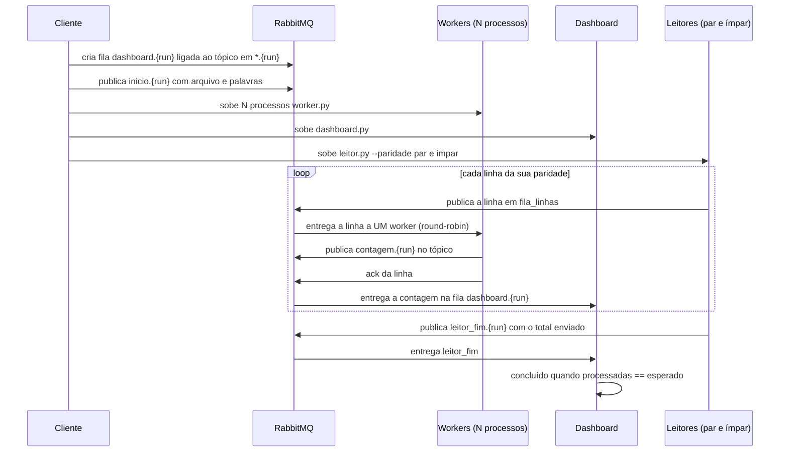

# Projeto MOM — Contagem paralela de palavras-chave

Workflow de computação paralela com **MOM (RabbitMQ)** em Python: dois leitores de linha
(pares/ímpares) alimentam uma **fila**; N workers consomem a fila, contam as palavras-chave e
publicam o resultado num **tópico**; o dashboard assina o tópico e atualiza os totais em tempo real.

## Como rodar

```bash
# 1) broker (precisa do Docker)
docker compose up -d

# 2) dependências (uma vez)
python3 -m venv .venv && ./.venv/bin/pip install -r requirements.txt   # tkinter vem com o Python (Ubuntu: sudo apt install python3-tk)

# 3) arquivo de teste (opcional) e aplicação
./.venv/bin/python scripts/gerar_arquivo.py 200000 data/entrada.txt
./.venv/bin/python src/cliente.py            # interface gráfica
```

### Ativando a venv (opcional)

Os comandos acima chamam `./.venv/bin/python` direto e funcionam sem ativar nada. Se preferir
digitar só `python`, ative a venv uma vez por terminal:

```bash
source .venv/bin/activate      # Linux/macOS (o prompt passa a mostrar "(.venv)")
# .venv\Scripts\activate       # Windows

python scripts/gerar_arquivo.py 200000 data/entrada.txt
python src/cliente.py

deactivate                     # para sair da venv
```

Sem interface (útil para testar): `python src/cliente.py --cli -a data/entrada.txt -p python,java,erro -w 3`.
Painel do broker: http://localhost:15672 (guest/guest). Outro host: variável `RABBITMQ_HOST`.

## O arquivo de entrada: `scripts/gerar_arquivo.py`

[gerar_arquivo.py](scripts/gerar_arquivo.py) é um **script auxiliar**, separado do sistema: **não
usa o RabbitMQ**. Ele faz duas coisas:

1. **Gera um arquivo de texto grande** para servir de entrada para a contagem.
2. **Imprime um gabarito**, isto é, quantas vezes algumas palavras aparecem no arquivo, para conferir
   se o dashboard acertou.

```bash
python scripts/gerar_arquivo.py 200000 data/entrada.txt
#                               ^^^^^^ ^^^^^^^^^^^^^^^^
#                               linhas  arquivo de saída (os dois são opcionais)
```

### Como ele funciona

1. **Vocabulário fixo de 26 palavras**, todas do tema do trabalho
   ([linhas 15-17](scripts/gerar_arquivo.py#L15-L17)): `python java erro sucesso fila topico broker
   mensagem worker leitor dashboard paralelo processo thread rede servidor cliente dados arquivo
   linha palavra contador sistema distribuido middleware evento`.
2. **Sorteador com semente fixa** ([linha 23](scripts/gerar_arquivo.py#L23)):
   `rnd = random.Random(42)`.
3. **Cada linha tem de 5 a 20 palavras sorteadas** do vocabulário, com a primeira letra maiúscula e
   um ponto no fim ([linhas 27-29](scripts/gerar_arquivo.py#L27-L29)).
4. **Ao mesmo tempo que escreve, ele conta as palavras** com um `Counter`, sem broker e sem
   paralelismo ([linha 30](scripts/gerar_arquivo.py#L30)).
5. **No fim, imprime o gabarito** ([linhas 31-32](scripts/gerar_arquivo.py#L31-L32)).

Exemplo com 3 linhas:

```
$ python scripts/gerar_arquivo.py 3 data/exemplo.txt
3 linhas gravadas em data/exemplo.txt
Contagem de referência: {'python': 2, 'java': 1, 'erro': 1, 'middleware': 0}

$ cat data/exemplo.txt
Python distribuido worker mensagem mensagem fila distribuido sucesso.
Arquivo thread java python erro broker mensagem.
Dados broker sistema palavra sistema.
```

### Por que ele gera sempre o mesmo arquivo

O computador não sorteia de verdade. Ele usa uma fórmula que, a partir de um número inicial (a
**semente**, aqui `42`), produz uma sequência que *parece* aleatória. Com a mesma semente, a
sequência é sempre a mesma.

Na prática:

- **Mesmo número de linhas** → **exatamente o mesmo arquivo**, byte a byte.
- **Mais linhas** → as primeiras continuam iguais, e o arquivo só fica mais comprido.

Isso torna os testes **repetíveis**. Você pode rodar com 1 worker e depois com 3 sobre o mesmo
arquivo para comparar o tempo, e sabe de antemão quais números o dashboard deve mostrar. Para gerar
um arquivo diferente, troque o `42` por outro número, ou use `random.Random()` sem número.

### Como usar o gabarito

Conte `python, java, erro, middleware` no arquivo gerado. Os totais do dashboard têm que ser
**iguais** à contagem de referência. Se forem, fica provado que, ao passar por leitores → fila →
workers → tópico → dashboard:

- **nenhuma linha se perdeu**;
- **nenhuma linha foi contada duas vezes**, mesmo com o trabalho dividido entre vários workers.

A maiúscula do início da linha ("Python") e o ponto no fim ("sucesso.") não atrapalham: o worker
conta sem diferenciar maiúsculas e minúsculas e só considera palavras inteiras
([config.py#L82-L87](src/config.py#L82-L87)).

## Docker e pika: como os programas falam com o RabbitMQ

**Resumo:** o **Docker** roda o RabbitMQ, que é o broker. O **pika** é a biblioteca Python que os
programas usam para falar com ele. **Só o RabbitMQ roda no Docker**: cliente, leitores, workers e
dashboard rodam direto no computador, pela venv, e se conectam ao broker pela porta 5672.

```
 Seu computador                                         Container Docker "mom_rabbitmq"
 ┌──────────────────────────────────┐                  ┌───────────────────────────────┐
 │ cliente.py   ─┐                  │                  │                               │
 │ leitor.py ×2 ─┤ pika             │   localhost:5672 │   RabbitMQ (broker)           │
 │ worker.py ×3 ─┼─────────────────────────────────────▶   fila_linhas                 │
 │ dashboard.py ─┘     (AMQP)       │                  │   topico_palavras             │
 │                                  │                  │   dashboard.<run>             │
 │ navegador ──────────────────────────────────────────▶   painel web                  │
 │                                  │  localhost:15672 │                               │
 └──────────────────────────────────┘                  └───────────────────────────────┘
```

### Docker: o broker num container

Todo o Docker do projeto está no [docker-compose.yml](docker-compose.yml):

```yaml
services:
  rabbitmq:
    image: rabbitmq:3-management
    container_name: mom_rabbitmq
    ports:
      - "5672:5672"
      - "15672:15672"
    healthcheck:
      test: ["CMD", "rabbitmq-diagnostics", "-q", "ping"]
      interval: 5s
      timeout: 5s
      retries: 12
```

| Linha | O que faz |
|---|---|
| `image: rabbitmq:3-management` | Usa a imagem oficial do RabbitMQ versão 3. O sufixo `-management` traz o **painel web**. |
| `container_name: mom_rabbitmq` | Dá um nome fixo ao container, para usar em `docker ps` e `docker exec`. |
| `ports: "5672:5672"` | Liga a porta 5672 **do computador** à porta 5672 **do container**. É a porta do protocolo **AMQP**, por onde o pika conversa com o broker. |
| `ports: "15672:15672"` | O mesmo para o painel web (http://localhost:15672, usuário e senha `guest`). |
| `healthcheck` | A cada 5 s, o Docker roda `rabbitmq-diagnostics ping` dentro do container para saber se o broker já responde. Depois disso, o container aparece como **healthy**. |

**Por que usar Docker:**

- **Nada a instalar:** o RabbitMQ é escrito em Erlang. Sem Docker, seria preciso instalar e
  configurar o Erlang e o RabbitMQ. Com Docker, basta um comando.
- **Mesma versão para todos:** você, os colegas e o professor rodam o mesmo broker.
- **Fácil de limpar:** `docker compose down` remove tudo, sem deixar resto no sistema.

**Comandos do dia a dia:**

```bash
docker compose up -d        # sobe o broker em segundo plano (-d = detached)
docker compose ps           # mostra o status; espere aparecer "healthy"
docker compose logs -f      # acompanha os logs do RabbitMQ (Ctrl+C para sair)
docker compose stop         # para o container, mas mantém filas e mensagens
docker compose down         # para E APAGA o container (perde filas e mensagens)

# olhar dentro do broker pelo terminal, sem o painel:
docker exec mom_rabbitmq rabbitmqctl list_queues name messages consumers
```

**Dois cuidados:**

1. **Espere o broker ficar pronto.** O RabbitMQ leva alguns segundos para subir. Se o cliente for
   aberto cedo demais, aparece "Não foi possível conectar ao RabbitMQ…"
   ([cliente.py#L54-L59](src/cliente.py#L54-L59)). Rode `docker compose ps` e espere o **healthy**.
2. **A persistência tem limite.** A `fila_linhas` é durável e as mensagens são persistentes, então
   elas sobrevivem a um **reinício** do broker (`docker compose stop` e depois `up`). Mas o
   `docker-compose.yml` não tem **volume**: os dados ficam dentro do container, e um
   `docker compose down` apaga tudo. Para sobreviver à remoção do container, seria preciso montar um
   volume em `/var/lib/rabbitmq`.

### pika: a biblioteca que fala com o broker

O **pika** (única dependência do [requirements.txt](requirements.txt)) é um **cliente** do
protocolo AMQP, o protocolo que o RabbitMQ fala. Não confunda: o MOM é o RabbitMQ, e o pika só
envia e recebe mensagens dele.

**Conexão e canal.** Tudo começa em [config.py#L32-L41](src/config.py#L32-L41):

```python
def conectar():
    params = pika.ConnectionParameters(
        host=BROKER_HOST,                 # "localhost", a porta que o Docker expõe
        port=BROKER_PORT,                 # 5672
        credentials=pika.PlainCredentials(BROKER_USER, BROKER_PASS),   # guest/guest
        heartbeat=60,                     # sinal periódico para detectar conexão morta
        blocked_connection_timeout=300,
    )
    return pika.BlockingConnection(params)
```

E cada programa faz:

```python
conn = config.conectar()     # 1 conexão TCP com o broker
canal = conn.channel()       # 1 canal dentro dela; todas as operações passam pelo canal
```

- **`BlockingConnection`** é a conexão **bloqueante** (síncrona): cada chamada espera a resposta do
  broker antes de seguir. É a forma mais simples de usar o pika.
- **Canal** é uma "conversa" dentro da conexão TCP. O projeto usa 1 canal por conexão. É isso que
  aparece nas abas *Connections* e *Channels* do painel.
- O endereço vem de variáveis de ambiente ([config.py#L23-L26](src/config.py#L23-L26)), com
  `localhost` como padrão. Com `RABBITMQ_HOST=<ip>`, os programas usam o broker de outra máquina,
  sem mudar o código.

**As chamadas do pika usadas no projeto:**

| Chamada | Para que serve | Onde |
|---|---|---|
| `queue_declare` | cria a fila, se ainda não existir (é **idempotente**) | [config.py#L46](src/config.py#L46), [config.py#L64](src/config.py#L64) |
| `exchange_declare` | cria o tópico (exchange do tipo `topic`) | [config.py#L47](src/config.py#L47) |
| `queue_bind` | liga a fila do dashboard ao tópico com o padrão `*.<run>` | [config.py#L65](src/config.py#L65) |
| `BasicProperties(delivery_mode=2)` | marca a mensagem como persistente (gravada em disco) | [leitor.py#L35](src/leitor.py#L35) |
| `basic_publish` | **publica** uma mensagem numa exchange | [leitor.py#L48](src/leitor.py#L48), [config.py#L70](src/config.py#L70) |
| `basic_qos` | define o **prefetch**: quantas mensagens sem ack o consumidor aceita | [worker.py#L28](src/worker.py#L28), [dashboard.py#L97](src/dashboard.py#L97) |
| `basic_consume` | registra o **callback** que recebe as mensagens de uma fila | [worker.py#L43](src/worker.py#L43), [dashboard.py#L98](src/dashboard.py#L98) |
| `start_consuming` | entra no laço que espera mensagens e chama o callback | [worker.py#L46](src/worker.py#L46), [dashboard.py#L99](src/dashboard.py#L99) |
| `basic_ack` | **confirma** que a mensagem foi processada; só então o broker a apaga | [worker.py#L41](src/worker.py#L41), [dashboard.py#L113](src/dashboard.py#L113) |
| `stop_consuming` / `queue_delete` | encerra o consumo e apaga a fila do dashboard | [dashboard.py#L119-L122](src/dashboard.py#L119-L122) |
| `add_callback_threadsafe` | pede, de outra thread, que a thread do pika execute uma função | [dashboard.py#L124](src/dashboard.py#L124) |

**O callback.** O pika chama a função registrada em `basic_consume` a cada mensagem, sempre com
quatro argumentos ([worker.py#L32](src/worker.py#L32)):

```python
def ao_receber(ch, metodo, props, corpo):
    msg = json.loads(corpo)                          # corpo chega em BYTES → JSON → dict
    ...
    ch.basic_ack(delivery_tag=metodo.delivery_tag)   # metodo traz o delivery_tag e a routing_key
```

| Argumento | O que é |
|---|---|
| `ch` | o canal, usado para publicar e dar ack de dentro do callback |
| `metodo` | dados da entrega: `delivery_tag` (o "número" da entrega, usado no ack) e `routing_key` (o dashboard usa para saber o tipo da mensagem) |
| `props` | propriedades da mensagem, como `delivery_mode` (o projeto não usa) |
| `corpo` | o conteúdo, em **bytes**. Por isso se publica com `json.dumps(...).encode("utf-8")` e se lê com `json.loads(corpo)` |

**O pika não é thread-safe.** Uma `BlockingConnection` só pode ser usada pela thread que a criou. Por
isso, no dashboard, **só a thread `Assinante` fala com o broker**. A interface recebe os dados por
uma `queue.Queue`, e para encerrar usa `add_callback_threadsafe`, que pede à própria thread do pika
para parar ([dashboard.py#L115-L126](src/dashboard.py#L115-L126)).

## Arquitetura (numeração do diagrama do enunciado)

| # | Componente | Arquivo | Papel no MOM |
|---|---|---|---|
| 1 | Cliente | `src/cliente.py` | pede arquivo/palavras, sobe workers, dashboard e os 2 leitores |
| 2 | Leitor de linhas (par e ímpar) | `src/leitor.py` | **Produtor** da fila |
| 3 | Fila de linhas | `fila_linhas` (RabbitMQ) | fila durável, entrega round-robin |
| 4 | Contador de palavras (workers) | `src/worker.py` | **Consumidor** da fila + **Publisher** do tópico |
| 5 | Tópico de palavras | exchange `topico_palavras` (tipo *topic*) | publish/subscribe |
| 6 | Dashboard | `src/dashboard.py` | **Subscriber** do tópico |

`src/config.py` concentra a conexão e a topologia; `scripts/gerar_arquivo.py` cria o arquivo de teste.

### Fluxo de mensagens

1. Cliente cria a fila `dashboard.<run>` já ligada ao tópico (`*.<run>`) e publica `inicio.<run>`
   (arquivo + palavras). Isso vem *antes* dos leitores porque o tópico não guarda mensagens:
   sem a fila pré-criada, o dashboard poderia perder as primeiras contagens.
2. Cada leitor lê o arquivo em streaming, e para cada linha da sua paridade publica
   `{run_id, linha, texto, palavras}` em `fila_linhas`. Linhas numeradas a partir de 1
   (ímpar = 1, 3, 5…; par = 2, 4, 6…).
3. Os workers (competing consumers) pegam linhas da fila, contam cada palavra-chave
   (palavra inteira, sem diferenciar maiúsculas/minúsculas), publicam `contagem.<run>` com
   `{linha, contagem, worker}` e só então dão **ack**. Se um worker morrer antes do ack, a
   linha volta para a fila e outro a processa (entrega *at-least-once*).
4. Ao terminar, cada leitor publica `leitor_fim.<run>` com quantas linhas enviou. O dashboard soma
   os dois totais e sabe que acabou quando `linhas processadas == linhas enviadas`.
5. O dashboard soma as contagens, mostra barras por palavra, progresso, linhas/s e quantas linhas
   cada worker processou (evidência do paralelismo).

### Decisões de projeto (para a explicação do código)

- **Por que fila e tópico?** A fila distribui *trabalho* (cada linha vai para **um** worker); o
  tópico distribui *informação* (todo assinante interessado recebe). É a diferença entre os dois
  modelos de MOM pedidos no enunciado.
- **Mensagens persistentes + fila durável** e **ack manual** garantem que nenhuma linha se perde.
- **`prefetch`=100** nos workers: cada um recebe um lote de linhas por vez, em vez de uma ida ao
  broker por linha.
- **Threads no dashboard:** o pika `BlockingConnection` não é thread-safe; só a thread assinante
  fala com o broker e entrega os dados à interface (tkinter) por uma `queue.Queue`.
- **Isolamento por `run_id`:** resultados de execuções antigas não se misturam com a atual.

### Limitações conhecidas

- Com entrega *at-least-once*, uma falha de worker entre publicar e dar ack pode contar uma linha
  duas vezes (raro; dedupe por número de linha exigiria guardar todos os números no dashboard).
- Palavras são comparadas literalmente: "ação" ≠ "acao".

---

## Como funciona o paralelismo

**Resposta curta:** cada worker é um **processo** separado, e todos consomem a **mesma fila**. O
broker entrega cada linha a um único worker, então N workers contam N lotes de linhas **ao mesmo
tempo**, em núcleos diferentes da CPU. Nenhum código do projeto divide o trabalho: quem divide é o
RabbitMQ.

O paralelismo vem de três mecanismos que trabalham juntos.

### 1. Processos, não threads

O cliente abre cada worker como um **processo** do sistema operacional
([cliente.py#L37-L41](src/cliente.py#L37-L41)):

```python
for i in range(len(self.workers), n):
    self.workers.append(_py("worker.py", "--id", str(i + 1), ...))   # _py = subprocess.Popen
```

**Por que processos?** Por causa do **GIL** do Python (veja [o que é GIL](#contexto-o-que-é-gil)).
Dentro de um processo, só uma thread executa código Python por vez. Contar palavras com regex é
trabalho de CPU, então 3 threads se revezariam num núcleo só. Já 3 processos têm 3 interpretadores
e 3 GILs, e o sistema operacional os coloca em 3 núcleos ao mesmo tempo.

```
 Threads (não usado)                 Processos (usado)
 ┌──────── 1 processo ────────┐      ┌─ processo ─┐ ┌─ processo ─┐ ┌─ processo ─┐
 │  GIL: uma thread por vez   │      │  worker-1  │ │  worker-2  │ │  worker-3  │
 │  T1 ▓▓░░░░▓▓░░░░           │      │  ▓▓▓▓▓▓▓▓  │ │  ▓▓▓▓▓▓▓▓  │ │  ▓▓▓▓▓▓▓▓  │
 │  T2 ░░▓▓░░░░▓▓░░           │      │  núcleo 1  │ │  núcleo 2  │ │  núcleo 3  │
 │  T3 ░░░░▓▓░░░░▓▓           │      └────────────┘ └────────────┘ └────────────┘
 └────────────────────────────┘
```

### 2. Competing consumers: o broker divide o trabalho

Todos os workers fazem `basic_consume` na **mesma fila** ([worker.py#L43](src/worker.py#L43)):

```python
canal.basic_consume(queue=config.FILA_LINHAS, on_message_callback=ao_receber)
```

Quando vários consumidores leem a mesma fila, o RabbitMQ entrega **cada mensagem a um só deles**,
revezando (*round-robin*). Esse padrão se chama **competing consumers** (consumidores concorrentes):
os workers "competem" pelas linhas. Por isso:

- **nenhum worker sabe dos outros**, e não há código de divisão, índice ou coordenação;
- para ter mais paralelismo, **basta abrir mais workers**, sem mudar nada no código;
- se um worker morrer, os outros continuam, e as linhas que ele não confirmou (ack) voltam para a
  fila.

### 3. Prefetch: lotes em vez de uma linha por vez

```python
canal.basic_qos(prefetch_count=100)     # worker.py#L28
```

O prefetch diz ao broker: "mande até **100 linhas sem ack** para este worker". Isso tem dois
efeitos:

- **Menos idas e vindas:** o worker já tem as próximas linhas na mão, em vez de pedir uma por uma
  pela rede.
- **Divisão justa:** o broker só manda mais linhas quando o worker confirma as anteriores. Um worker
  mais lento recebe menos, e os mais rápidos pegam o resto. A carga se ajusta sozinha.

Sem `basic_qos`, o broker repartiria as linhas num rodízio cego: cada worker receberia a mesma
quantidade, fosse rápido ou lento, e todas as linhas se acumulariam na memória dos workers. Os
detalhes estão em [Round-robin](#round-robin-como-o-broker-reparte-as-linhas).

A demo deve usar um **arquivo grande**. Na primeira execução, os workers são abertos junto com os
leitores, e o primeiro worker a se conectar já pode levar 100 linhas de uma vez. Com um arquivo
pequeno, ele pode fazer quase tudo sozinho, e a demo parece não ter paralelismo.

### Além dos workers: as etapas também rodam ao mesmo tempo

Os leitores, os workers e o dashboard são processos separados, e as linhas passam pela fila como
numa **linha de montagem**. Ninguém espera a etapa anterior terminar:

```
tempo ─────────────────────────────────────────────────────────▶
leitor ímpar  ▓▓▓▓▓▓▓▓▓▓▓▓▓▓▓▓▓▓
leitor par    ▓▓▓▓▓▓▓▓▓▓▓▓▓▓▓▓▓▓
worker-1        ▓▓▓▓▓▓▓▓▓▓▓▓▓▓▓▓▓▓▓▓▓▓
worker-2        ▓▓▓▓▓▓▓▓▓▓▓▓▓▓▓▓▓▓▓▓▓▓
worker-3        ▓▓▓▓▓▓▓▓▓▓▓▓▓▓▓▓▓▓▓▓▓▓
dashboard         ▓▓▓▓▓▓▓▓▓▓▓▓▓▓▓▓▓▓▓▓▓▓
```

Enquanto os leitores ainda leem o fim do arquivo, os workers já contam as primeiras linhas e o
dashboard já está somando.

### Por que o resultado sai certo, mesmo fora de ordem

Os workers terminam as linhas em **qualquer ordem**: a linha 7 pode chegar ao dashboard antes da
linha 2. Isso não importa, porque o dashboard só **soma**, e a ordem das parcelas não muda a soma.
O número da linha vai na mensagem só para rastreio.

O que importa é que **cada linha seja contada uma vez**, e isso a fila garante: cada mensagem vai
para um único worker e só sai da fila depois do ack. A única exceção é rara: se um worker morrer
**depois** de publicar a contagem e **antes** do ack, a linha volta para a fila e é contada duas
vezes (veja *Limitações conhecidas*).

### O que **não** é paralelo

Vale saber para não ser pego de surpresa:

- **Os dois leitores não dividem a leitura do disco.** Cada um lê o arquivo **inteiro** e descarta
  as linhas da outra paridade. A divisão par/ímpar é exigência do enunciado. Ler é barato comparado
  a contar, então isso pesa pouco.
- **O dashboard é um só.** Ele recebe e soma todas as contagens sozinho, mas somar números é muito
  mais leve que aplicar regex.
- **O ganho não é proporcional.** 3 workers não deixam a execução exatamente 3× mais rápida: cada
  linha também passa pela rede, é convertida para JSON e é confirmada no broker, e essa parte custa
  o mesmo com 1 ou com 3 workers.

### Como ver o paralelismo acontecendo

| Onde | O que olhar |
|---|---|
| **Dashboard** | O quadro "Linhas processadas por worker" mostra cada worker com uma parte parecida do total |
| **Dashboard** | O campo "linhas/s": rode o mesmo arquivo com 1 worker e depois com 3, e compare |
| **RabbitMQ** (http://localhost:15672) | Aba **Queues**: `fila_linhas` com *Consumers = 3* |
| **RabbitMQ** | Aba **Channels**: cada worker com *Prefetch 100* e linhas *Unacked* |
| **Terminal** (`htop` ou `top`) | 3 processos `python worker.py` usando CPU ao mesmo tempo |

O mesmo arquivo gerado por [gerar_arquivo.py](scripts/gerar_arquivo.py) dá sempre o mesmo
gabarito, então os totais têm que bater com 1, 3 ou 10 workers. Esse é o teste de que o paralelismo
não perdeu nem duplicou linhas.

## Round-robin: como o broker reparte as linhas

**Resposta curta:** o RabbitMQ entrega as linhas da `fila_linhas` aos workers **em rodízio**
(worker-1, worker-2, worker-3, worker-1…), mas **pula quem está cheio**. "Cheio" quer dizer ter 100
linhas recebidas e ainda não confirmadas (o `prefetch`). Então, no começo, a divisão é um rodízio
certinho. Depois, quem confirma (ack) primeiro recebe a próxima linha, e o worker mais rápido acaba
fazendo mais.

### As três linhas de código envolvidas

Todas ficam no [worker.py](src/worker.py):

```python
canal.basic_qos(prefetch_count=100)                                     # L28: limite de linhas sem ack
canal.basic_consume(queue=config.FILA_LINHAS, on_message_callback=...)  # L43: entra no rodízio
ch.basic_ack(delivery_tag=metodo.delivery_tag)                          # L41: "terminei", libera uma vaga
```

- `basic_consume` registra o worker como **consumidor** da fila. O broker guarda a lista de
  consumidores e faz o rodízio entre eles.
- `basic_qos(prefetch_count=100)` dá a cada worker **100 vagas**: no máximo 100 linhas entregues e
  ainda não confirmadas.
- `basic_ack` confirma uma linha. Ela sai da fila de vez e **libera uma vaga** para o broker mandar
  outra.

### O que o broker faz quando chega uma linha

```
 chegou uma linha na fila_linhas
              │
              ▼
 próximo worker do rodízio ──▶ tem vaga (menos de 100 sem ack)?
              ▲                       │               │
              │                      sim             não
              │                       │               │
              │                       ▼               ▼
              │              entrega a linha    pula para o próximo
              │              a esse worker             │
              │                                        │
              └────────────────────────────────────────┘
       (se ninguém tem vaga, a linha espera na fila como "Ready")
```

### Um exemplo acompanhado passo a passo

Para o exemplo caber aqui: **3 workers**, **prefetch = 2** (no projeto é 100) e **9 linhas**
(L1 a L9).

**Fase 1: rodízio certinho, até todos lotarem.** As linhas chegam e o broker as entrega em ordem
de rodízio:

| Linha | Vai para | Linhas sem ack (w1 / w2 / w3) |
|---|---|---|
| L1 | worker-1 | 1 / 0 / 0 |
| L2 | worker-2 | 1 / 1 / 0 |
| L3 | worker-3 | 1 / 1 / 1 |
| L4 | worker-1 | 2 / 1 / 1 |
| L5 | worker-2 | 2 / 2 / 1 |
| L6 | worker-3 | 2 / 2 / 2 ← **todos cheios** |
| L7, L8, L9 | **ficam na fila** (*Ready*) | ninguém tem vaga |

**Fase 2: quem confirma primeiro recebe a próxima.** Agora a velocidade de cada worker é que
decide. Suponha que o worker-2 seja o mais rápido e o worker-3 o mais lento:

| Acontecimento | O broker faz | Linhas sem ack (w1 / w2 / w3) |
|---|---|---|
| worker-2 dá ack em L2 | manda **L7** para o worker-2 | 2 / 2 / 2 |
| worker-1 dá ack em L1 | manda **L8** para o worker-1 | 2 / 2 / 2 |
| worker-2 dá ack em L5 | manda **L9** para o worker-2 | 2 / 2 / 2 |
| fila vazia, os workers confirmam o que restou | (nada a mandar) | 0 / 0 / 0 |

**Resultado:**

| Worker | Linhas | Total |
|---|---|---|
| worker-1 | L1, L4, L8 | 3 |
| worker-2 (mais rápido) | L2, L5, L7, L9 | **4** |
| worker-3 (mais lento) | L3, L6 | **2** |

O rodízio começou igual para todos, mas **o trabalho se ajustou à velocidade** de cada worker. É por
isso que, no dashboard, os números por worker ficam **parecidos, mas não idênticos**.

### Com e sem prefetch

| | Sem `basic_qos` (rodízio cego) | Com `prefetch_count=100` (o projeto) |
|---|---|---|
| Como reparte | rigorosamente 1, 2, 3, 1, 2, 3… | rodízio, pulando quem tem 100 linhas sem ack |
| Worker lento | recebe a **mesma quantidade** e atrasa o fim de tudo | recebe **menos**, e os outros compensam |
| Onde ficam as linhas esperando | na memória dos workers | **na fila do broker** |
| Se um worker morrer | todas as linhas que ele tinha recebido voltam para a fila | no máximo 100 voltam |

E por que **100**, e não 1?

- **Prefetch 1** dá a divisão mais justa possível, mas o worker fica parado esperando a rede a cada
  linha (confirma, espera chegar a próxima, conta, confirma…).
- **Prefetch 100** mantém sempre linhas "na mão" do worker, que nunca fica ocioso, e ainda deixa o
  broker equilibrar a carga.

### Detalhes que fazem diferença

- **O rodízio é por mensagem, não por paridade.** Não existe "worker das linhas pares". Os dois
  leitores publicam na mesma fila, as linhas pares e ímpares se misturam ali, e o rodízio pega
  qualquer uma.
- **Só entra no rodízio quem já está conectado.** Na primeira execução, os workers e os leitores
  são abertos quase juntos, e o worker que se conecta primeiro pode já levar 100 linhas antes de os
  outros chegarem. Com arquivo grande isso não importa; com arquivo pequeno, a divisão fica
  desigual.
- **Ordem das linhas.** Cada worker processa as suas em ordem, mas, entre workers diferentes, as
  contagens chegam ao dashboard fora de ordem. Como o dashboard só soma, o resultado não muda.

### Onde ver no RabbitMQ (http://localhost:15672)

Durante uma execução com arquivo grande e 3 workers:

| Aba | O que olhar | O que significa |
|---|---|---|
| **Queues** → `fila_linhas` | *Consumers* = 3 | os 3 workers estão no rodízio |
| **Queues** → `fila_linhas` | *Unacked* até 300 | 3 workers × 100 linhas de prefetch |
| **Queues** → `fila_linhas` | *Ready* | linhas esperando porque todos os workers estão cheios |
| **Channels** | *Prefetch* = 100 e *Unacked* em cada canal | quanto cada worker está segurando agora |

Se *Ready* fica crescendo, os leitores estão publicando mais rápido do que os workers conseguem
contar. É nesse caso que vale abrir mais workers.

---

## Roteiro da demonstração ao vivo

Sequência para mostrar a aplicação funcionando, com **o que fazer** e **o que falar** em cada passo.
Faça a demonstração **antes** de entrar no código: depois de ver a aplicação rodando, o professor
entende melhor cada trecho que você mostrar.

### Antes da apresentação (preparação)

Faça isto antes de o professor chegar e **ensaie a demonstração inteira uma vez**:

```bash
docker compose up -d                       # sobe o broker
docker compose ps                          # espere aparecer "healthy"
source .venv/bin/activate                  # ativa a venv
```

Deixe abertos: **um terminal** na pasta do projeto, o **painel do RabbitMQ**
(http://localhost:15672, `guest`/`guest`) e o **VS Code**.

Os números esperados do arquivo de 200 mil linhas (gabarito do `gerar_arquivo.py`) são:

| python | java | erro | middleware |
|---|---|---|---|
| 95.909 | 96.307 | 95.881 | 95.820 |

### Passo 1: gerar o dataset

**Fazer:**

```bash
python scripts/gerar_arquivo.py 200000 data/entrada.txt
head -3 data/entrada.txt
```

**Falar:**
> "Primeiro eu gero o dataset. Esse script cria um arquivo com 200 mil linhas, cada uma com 5 a 20
> palavras sorteadas de um vocabulário fixo. Como a semente do sorteio é fixa, o arquivo sai sempre
> igual. E, enquanto gera, o script já conta as palavras e imprime esta contagem de referência, que
> é o nosso **gabarito**. No fim, o dashboard tem que mostrar exatamente estes números."

Aponte a linha "Contagem de referência" no terminal e deixe esses números visíveis.

### Passo 2: mostrar o broker

**Fazer:** no painel do RabbitMQ, abra a aba **Exchanges** e depois a aba **Queues**.

**Falar:**
> "Este é o RabbitMQ, o broker, rodando num container Docker. Ele é o intermediário: nenhum programa
> fala direto com outro, todos falam com ele. Aqui está o `topico_palavras`, a exchange do tipo
> topic por onde passam os resultados. A fila de linhas, a `fila_linhas`, é onde os leitores vão
> colocar o trabalho."

### Passo 3: abrir o cliente

**Fazer:**

```bash
python src/cliente.py
```

**Falar:**
> "Este é o cliente, o ponto de partida da aplicação. Ele pede três coisas: o arquivo de entrada, as
> palavras-chave que eu quero contar e quantos workers vão trabalhar em paralelo."

### Passo 4: preencher a interface

**Fazer:**
- **Arquivo de entrada:** clique em **Procurar…** e escolha `data/entrada.txt`.
- **Palavras-chave:** `python, java, erro, middleware`
- **Workers:** `3`

**Falar:**
> "Escolho o arquivo que acabei de gerar, as mesmas quatro palavras do gabarito e 3 workers. Cada
> worker vai ser um processo separado do sistema operacional, então os três vão contar ao mesmo
> tempo, em núcleos diferentes."

### Passo 5: clicar em "Iniciar contagem" e ler o log

**Fazer:** clique em **▶ Iniciar contagem**. Aponte cada linha que aparecer no **Log**:

| Linha do log | Falar |
|---|---|
| `Execução ab12cd34: palavras = python, java, erro, middleware` | "O cliente gerou um identificador para esta execução, criou no broker a fila do dashboard já ligada ao tópico e publicou a mensagem de início." |
| `3 worker(s) ativo(s)` | "Subiu os 3 workers. Eles se conectam ao broker e ficam esperando linhas na fila." |
| `Dashboard aberto` | "Abriu o dashboard, que é quem vai receber os resultados." |
| `Leitores de linhas pares e ímpares iniciados` | "E, por último, os dois leitores." |
| `[leitor impar] iniciado` / `[leitor par] iniciado` | "Os dois leitores leem o mesmo arquivo: um fica com as linhas ímpares e o outro com as pares. Assim o dataset é dividido em dois conjuntos. Cada leitor publica as suas linhas, uma por uma, na **mesma** fila." |
| `[leitor impar] terminou: 100000 linhas enviadas` | "Cada leitor enviou 100 mil linhas, metade do arquivo, e avisou o total pelo tópico. É assim que o dashboard sabe quantas linhas esperar." |

Um cuidado na fala: os conjuntos par e ímpar **não vão para workers diferentes**. Os dois leitores
publicam na mesma fila, as linhas se misturam ali, e qualquer worker pode pegar qualquer linha. Se o
professor perguntar, explique:
> "A divisão par/ímpar é na leitura. A divisão entre os workers quem faz é o broker, em rodízio."

### Passo 6: acompanhar o dashboard

**Fazer:** aponte cada parte da janela do dashboard enquanto ela atualiza:

| Parte da janela | Falar |
|---|---|
| Status **"Processando… (leitores ainda lendo o arquivo)"** e barra em movimento | "Os workers já estão contando enquanto os leitores ainda leem. As etapas rodam ao mesmo tempo, como numa linha de montagem." |
| Barra de progresso ficando **determinada** ("X de 200.000 linhas") | "Quando os dois leitores avisaram o total, o dashboard passou a saber quantas linhas esperar, e a barra mostra o progresso real." |
| **"Ocorrências por palavra-chave"** (barras crescendo) | "Cada worker publica no tópico a contagem de uma linha, e o dashboard, que assina o tópico, vai somando." |
| **"Linhas processadas por worker"** | "Esta é a prova do paralelismo: os três workers processaram partes parecidas do arquivo. O broker repartiu as linhas entre eles, sem nenhum código de divisão." |
| **linhas/s** | "Esta é a vazão, quantas linhas por segundo o sistema está processando." |

### Passo 7: mostrar o broker durante a execução

Se a execução terminar rápido demais, rode de novo só para este passo.

**Fazer:** volte ao painel do RabbitMQ, aba **Queues**, e clique em `fila_linhas`.

**Falar:**
> "Aqui a `fila_linhas` mostra **3 consumidores**, que são os 3 workers lendo a mesma fila. A coluna
> *Unacked* mostra as linhas que os workers já pegaram e ainda não confirmaram: cada um segura até
> 100, que é o prefetch. Esta outra fila, `dashboard.<id>`, é a fila do dashboard ligada ao tópico."

### Passo 8: concluir e conferir com o gabarito

**Fazer:** espere o status **"✔ Concluído"** e compare os totais com o gabarito do Passo 1.

**Falar:**
> "Concluído. Os totais batem exatamente com o gabarito: python 95.909, java 96.307, erro 95.881 e
> middleware 95.820. Isso mostra que as 200 mil linhas passaram por leitores, fila, workers, tópico e
> dashboard sem nenhuma se perder e sem nenhuma ser contada duas vezes, mesmo divididas entre três
> processos."

### Extras (se houver tempo)

**A) Comparar 1 worker com 3.** Os workers continuam vivos entre execuções, e o cliente só **cria**
os que faltam, nunca encerra os que sobram. Por isso a ordem importa:

1. Feche o cliente (isso encerra os workers) e abra de novo.
2. Rode com **1 worker** e anote o **linhas/s**.
3. Na mesma janela, rode com **3 workers** (o cliente cria mais 2) e compare.

> "Com 3 workers a vazão sobe. Não fica exatamente 3 vezes maior, porque cada linha também passa
> pela rede e pelo broker, e essa parte não se divide."

**B) Matar um worker no meio.** É o teste que mais impressiona, mas **ensaie antes**. Se 200 mil
linhas terminarem rápido demais, gere um arquivo maior (ex.: `1000000`).

```bash
pgrep -af worker.py        # mostra os PIDs dos workers
kill <PID de um deles>     # durante a contagem
```

> "Matei um worker no meio da contagem. As linhas que ele tinha pego e não tinha confirmado voltaram
> para a fila, e os outros dois terminaram o trabalho. O total continua batendo com o gabarito."

No dashboard, o contador desse worker para de subir, e os outros continuam.

Existe um caso raro: se o worker morrer **entre** publicar uma contagem e dar o ack, aquela linha é
contada duas vezes, e o total sai 1 ou 2 acima do gabarito. Se acontecer, explique que a entrega é
*at-least-once* (veja *Limitações conhecidas*).

### Fala de encerramento

> "Resumindo o que vocês viram: os leitores dividiram o arquivo em linhas pares e ímpares e as
> colocaram numa fila. O broker repartiu essas linhas entre três workers, que contaram em paralelo e
> publicaram os resultados num tópico. O dashboard assinou esse tópico e somou tudo. A fila dividiu
> o **trabalho**, e o tópico difundiu a **informação**. Agora eu mostro onde cada coisa está no
> código."

Daí em diante, siga as perguntas abaixo.

---

## Perguntas da apresentação

Respostas às quatro perguntas, com link para a linha exata do código. Antes delas, dois conceitos
que aparecem em todas as respostas: MOM e GIL.

**Como usar na apresentação:** um monitor com o VS Code e o outro com este README. Cada pergunta
tem uma **resposta curta**, uma **abertura** (falar antes da tabela), uma **tabela** para seguir
linha a linha, um **fechamento** e respostas para as perguntas de continuação mais prováveis. Para
cada linha da tabela:

1. No VS Code, aperte **Ctrl+P** e digite o que está na coluna **Abrir** (ex.: `cliente.py:180`).
   O arquivo abre direto na linha.
2. Mostre o trecho da coluna **Mostrar**.
3. Fale o texto da coluna **Fala**.

### Contexto: o que é MOM

**MOM (Message-Oriented Middleware)** é um software intermediário que permite a programas trocarem
**mensagens** sem falar diretamente uns com os outros. Em vez de o programa A chamar o programa B, A
entrega a mensagem a um **broker** (o "carteiro"), e o broker a entrega a quem tiver interesse.

Isso traz três tipos de **desacoplamento**:

| Desacoplamento | O que significa | No projeto |
|---|---|---|
| **Espaço** | quem envia não sabe quem recebe, nem onde ele está | o leitor não sabe quantos workers existem nem quais são |
| **Tempo** | quem envia e quem recebe não precisam estar ativos ao mesmo tempo, porque a fila guarda a mensagem | as linhas ficam na `fila_linhas` até algum worker pegar |
| **Sincronização** | quem envia não fica esperando a resposta | o leitor publica e já segue para a próxima linha |

O MOM tem **dois modelos** de comunicação, e o projeto usa os dois:

| Modelo | Como funciona | No projeto |
|---|---|---|
| **Ponto a ponto (fila)** | cada mensagem é entregue a **um único** consumidor. Com vários consumidores na mesma fila, o broker reparte as mensagens entre eles | `fila_linhas`: cada linha vai para **um** worker. É assim que o trabalho é dividido |
| **Publish/subscribe (tópico)** | a mensagem é entregue a **todos** os assinantes interessados | `topico_palavras`: os resultados vão para quem assinou, no caso o dashboard |

**Peças usadas neste projeto:**

- **RabbitMQ** é o broker, ou seja, o MOM de fato. Ele roda no Docker
  ([docker-compose.yml](docker-compose.yml)).
- **AMQP** é o protocolo de rede que o RabbitMQ fala.
- **pika** é a biblioteca Python que fala AMQP. Ela é só o *cliente* do broker.
- **Exchange** é o lugar onde se publica no RabbitMQ. Ninguém publica direto numa fila: a exchange
  recebe a mensagem e a encaminha para as filas segundo a *routing key*.
  - **Exchange padrão (`""`)** entrega direto na fila cujo nome é igual à routing key. É o que o
    leitor usa para mandar linhas para a `fila_linhas`.
  - **Exchange do tipo topic** entrega para as filas cujo padrão casa com a routing key (`*` casa
    exatamente uma palavra). A fila `dashboard.ab12` está ligada a `*.ab12`, então recebe
    `contagem.ab12`, `inicio.ab12` e `leitor_fim.ab12`.
- **Ack** é a confirmação de que o consumidor terminou de processar. Enquanto não chega o ack, o
  broker guarda a mensagem. Se o consumidor morrer antes de confirmar, o broker a entrega a outro.

### Contexto: o que é GIL

O **GIL (Global Interpreter Lock)** é uma trava do CPython (o Python "normal") que permite que
**apenas uma thread por processo execute código Python de cada vez**. Mesmo numa máquina com 8
núcleos, 8 threads Python que fazem cálculo se revezam num núcleo só. A troca entre elas é tão
rápida que parece paralelo, mas não é.

O GIL **é liberado** quando a thread fica esperando I/O (rede, disco, `time.sleep`). Por isso:

| Tipo de tarefa | Threads ajudam? | Por quê |
|---|---|---|
| **I/O-bound** (esperar rede ou disco) | **Sim** | enquanto uma thread espera, ela solta o GIL e outra roda |
| **CPU-bound** (calcular, aplicar regex) | **Não** | só uma thread por vez segura o GIL |

**Como isso decide a arquitetura do projeto:**

- **Contar palavras** (aplicar regex em cada linha) é trabalho de **CPU**. Com threads, os workers se
  revezariam no GIL e não haveria ganho. Por isso cada worker é um **processo** separado
  (`subprocess.Popen`). Cada processo tem o próprio interpretador e o próprio GIL, e o sistema
  operacional os roda em núcleos diferentes ao mesmo tempo.
- Isso combina com o MOM. Como os workers só se comunicam pelo broker, poderiam até rodar em
  **máquinas diferentes**, bastando apontar `RABBITMQ_HOST` para o broker.
- **No dashboard as threads não servem para ganhar velocidade.** Elas existem porque há **dois laços
  que bloqueiam para sempre**: o `start_consuming()` do pika (espera mensagens da rede) e o
  `mainloop()` do tkinter (espera eventos da janela). Cada laço precisa da sua própria thread. Como
  a thread do pika passa quase todo o tempo esperando a rede, ela solta o GIL e não atrapalha a
  interface.

> Observação: o Python 3.13 trouxe uma versão experimental *free-threaded*, sem GIL (PEP 703), que
> precisa ser instalada à parte. O Python padrão, usado aqui, continua com GIL.

### 1. Mostre a sequência de execução

**Resposta curta:** o cliente prepara o broker e sobe os processos nesta ordem: fila do dashboard,
aviso `inicio`, workers, dashboard e leitores. Os leitores enviam as linhas para a fila. Os workers
contam e publicam no tópico. O dashboard soma tudo e para quando `processadas == esperado`.



**Abertura:**
> "A execução começa no cliente, que funciona como orquestrador. Vou seguir o caminho de uma
> execução, do clique no botão até o dashboard mostrar 'Concluído'."

| # | Abrir | Mostrar | Fala |
|---|---|---|---|
| 1 | [cliente.py:180](src/cliente.py#L180) | `orq.iniciar(...)` | "Quando o usuário clica em **Iniciar contagem**, a interface chama o método `iniciar` do Orquestrador, passando o arquivo, as palavras-chave e o número de workers." |
| 2 | [cliente.py:45](src/cliente.py#L45) | validação e `run_id` (L45-51) | "Primeiro ele valida o arquivo e as palavras e gera um `run_id`, um identificador curto dessa execução. Esse id vai em todas as mensagens, para uma execução não se misturar com outra." |
| 3 | [cliente.py:55](src/cliente.py#L55) | `conectar()` e `preparar_dashboard` (L55-61) | "Depois ele conecta no RabbitMQ e cria a fila do dashboard, já ligada ao tópico. Isso vem antes de tudo porque o tópico não guarda mensagens: se a fila ainda não existisse quando o primeiro worker publicasse, essa contagem se perderia." |
| 4 | [config.py:54](src/config.py#L54) | `preparar_dashboard` (L54-66) | "Aqui está a criação: um `queue_declare` cria a fila `dashboard.<run_id>`, e o `queue_bind` a liga ao tópico com o padrão asterisco-ponto-run_id." |
| 5 | [cliente.py:62](src/cliente.py#L62) | `publicar_topico(..., "inicio", ...)` | "Em seguida ele publica no tópico a mensagem `inicio`, com o arquivo e as palavras. É assim que o dashboard fica sabendo o que vai contar." |
| 6 | [cliente.py:37](src/cliente.py#L37) | `_garantir_workers` (L37-41) | "Aí ele sobe os workers. Cada worker é um processo separado. Se já existem workers vivos de uma execução anterior, ele os reaproveita e só cria os que faltam." |
| 7 | [cliente.py:72](src/cliente.py#L72) | abertura do dashboard (L72-73) | "Abre o dashboard, também como processo separado, passando o `run_id`." |
| 8 | [cliente.py:77](src/cliente.py#L77) | `for paridade in ("par", "impar")` (L77-83) | "Por último, os dois leitores: um para as linhas pares e outro para as ímpares. Eles vêm por último de propósito: quando começam a publicar, todo o resto já está pronto para receber." |
| 9 | [leitor.py:39](src/leitor.py#L39) | laço de leitura e `basic_publish` (L39-49) | "Cada leitor lê o arquivo linha a linha, fica só com as linhas da sua paridade e publica cada uma como uma mensagem JSON na `fila_linhas`." |
| 10 | [worker.py:32](src/worker.py#L32) | `ao_receber` (L32-41) | "O RabbitMQ entrega cada linha a um único worker. O worker conta as palavras, publica a contagem no tópico e só então confirma com o ack." |
| 11 | [leitor.py:52](src/leitor.py#L52) | `leitor_fim` (L52-53) | "Quando chega ao fim do arquivo, cada leitor publica `leitor_fim` com o número de linhas que enviou." |
| 12 | [dashboard.py:38](src/dashboard.py#L38) | `processar` e `concluido` (L38-60) | "O dashboard vai somando as contagens. Quando recebe os dois `leitor_fim`, ele sabe o total esperado, e a execução termina quando as linhas processadas chegam a esse total." |

**Fechamento:**
> "Resumindo: o cliente prepara, os leitores produzem, a fila distribui, os workers contam, o tópico
> difunde e o dashboard soma."

**Se ele perguntar…**
- *"Por que a fila do dashboard é criada antes dos leitores?"* → "Porque a exchange do tipo topic
  não armazena nada. Se ninguém estiver ligado a ela no momento da publicação, a mensagem é
  descartada."
- *"Como o dashboard sabe que acabou, se as linhas chegam fora de ordem?"* → "Ele não depende da
  ordem: compara quantas contagens recebeu com a soma dos totais que os dois leitores informaram."

### 2. Onde fica o código das threads

**Resposta curta:** o paralelismo da contagem **não** usa threads. Cada worker é um **processo**
separado, porque em Python o GIL impede que threads rodem código Python em paralelo. Threads de
verdade existem em dois pontos: o **dashboard**, com a thread `Assinante`, e o **cliente**, com as
threads que repassam o log dos leitores.

**Abertura:**
> "Antes de mostrar, uma observação importante: o paralelismo da contagem **não** está em threads,
> está em processos, por causa do GIL do Python. Threads de verdade o projeto tem em dois lugares,
> e eu vou mostrar os dois."

| # | Abrir | Mostrar | Fala |
|---|---|---|---|
| 1 | [cliente.py:26](src/cliente.py#L26) | `_py` com `subprocess.Popen` | "Esta é a função que cria processos. Workers, leitores e dashboard são todos processos abertos por ela. Os workers são processos porque contar palavras é trabalho de CPU: com threads, o GIL faria elas se revezarem num núcleo só. Com processos, cada worker tem o próprio interpretador e roda em outro núcleo." |
| 2 | [dashboard.py:77](src/dashboard.py#L77) | `class Assinante(threading.Thread)` (L77-90) | "Esta é a primeira thread: a classe `Assinante`, que herda de `threading.Thread`. Ela é `daemon`, então é encerrada junto com o programa." |
| 3 | [dashboard.py:163](src/dashboard.py#L163) | `Assinante(...)` e `ass.start()` | "Aqui ela é criada e iniciada com `start()`. A partir deste ponto o dashboard tem duas threads: a Assinante e a principal." |
| 4 | [dashboard.py:166](src/dashboard.py#L166) | `root = tk.Tk()` … `root.mainloop()` (L280) | "A thread principal é a da interface gráfica, o tkinter, que fica rodando no `mainloop`." |
| 5 | [cliente.py:83](src/cliente.py#L83) | `threading.Thread(target=self._repassar)` | "A segunda thread fica no cliente: uma para cada leitor." |
| 6 | [cliente.py:88](src/cliente.py#L88) | `_repassar` (L88-90) | "Ela só lê a saída do leitor e joga no log da janela, para a interface não travar esperando o leitor imprimir." |

**Fechamento:**
> "Então: threads no dashboard e no cliente, para a interface não travar enquanto espera rede ou
> processo; e processos nos workers, para ter paralelismo de verdade."

**Se ele perguntar…**
- *"Por que não threads nos workers?"* → "Por causa do GIL: no CPython só uma thread executa código
  Python por vez dentro de um processo. Contar com regex é CPU pura, então não haveria ganho."
- *"Então para que serve thread no Python?"* → "Para tarefas que esperam I/O, como rede e disco.
  Enquanto espera, a thread solta o GIL e outra roda. É exatamente o caso da Assinante, que passa
  quase o tempo todo esperando mensagem da rede."

### 3. O que eu executo nas threads

**Resposta curta:** a thread `Assinante` é a **única** que fala com o RabbitMQ (o pika
`BlockingConnection` não é thread-safe). Ela recebe as mensagens do tópico e as entrega à thread da
interface por uma `queue.Queue`. A thread da interface lê essa fila a cada 100 ms, soma os valores e
redesenha a tela.

```
 RabbitMQ ──▶ [Thread Assinante] ──queue.Queue──▶ [Thread principal / tkinter]
              conecta, consome, ack                 lê a fila a cada 100 ms,
              (só ela usa o pika)                   soma (Estado) e desenha
```

**Abertura:**
> "No dashboard existem dois laços que rodam para sempre: o do pika, esperando mensagens do
> RabbitMQ, e o do tkinter, esperando eventos da janela. Os dois bloqueiam, então cada um precisa
> da sua própria thread."

| # | Abrir | Mostrar | Fala |
|---|---|---|---|
| 1 | [dashboard.py:92](src/dashboard.py#L92) | `run()` (L92-99) | "Este é o `run` da thread Assinante, ou seja, o que ela executa. Ela abre a conexão com o RabbitMQ, define o prefetch, registra o callback com `basic_consume` e entra no `start_consuming`, que fica esperando mensagens." |
| 2 | [dashboard.py:80](src/dashboard.py#L80) | docstring (L80-81) | "Ela é a **única** thread que fala com o RabbitMQ, porque a conexão bloqueante do pika não é thread-safe. Se duas threads usassem a mesma conexão, a comunicação podia se corromper." |
| 3 | [dashboard.py:110](src/dashboard.py#L110) | `_ao_receber` (L110-113) | "A cada mensagem, o pika chama este callback, ainda dentro da thread Assinante. Ele pega o tipo da mensagem pela routing key (`contagem`, `inicio` ou `leitor_fim`), coloca numa `queue.Queue` e dá o ack." |
| 4 | [dashboard.py:235](src/dashboard.py#L235) | `atualizar()` (L235-250) | "Do outro lado, a thread principal executa esta função `atualizar` a cada 100 milissegundos. Ela tira da `queue.Queue` o que chegou e passa para o Estado." |
| 5 | [dashboard.py:38](src/dashboard.py#L38) | `Estado.processar` (L38-56) | "O Estado só faz contas: soma as ocorrências de cada palavra, conta quantas linhas cada worker processou e guarda o total esperado." |
| 6 | [dashboard.py:272](src/dashboard.py#L272) | `root.after(100, atualizar)` | "E esta linha agenda a próxima atualização. É assim que a interface fica sempre responsiva: ela nunca para esperando a rede." |
| 7 | [dashboard.py:115](src/dashboard.py#L115) | `parar()` (L115-126) | "Para encerrar, a thread principal não pode mexer na conexão diretamente. Ela usa `add_callback_threadsafe`, que pede à própria thread do pika para apagar a fila e parar o consumo." |
| 8 | [worker.py:32](src/worker.py#L32) | `ao_receber` do worker (L32-41) | "E nos workers, que são processos, o trabalho executado é este callback: lê o JSON, conta as palavras com regex, publica no tópico e confirma com ack." |

**Fechamento:**
> "A `queue.Queue` é a ponte entre as duas threads. Ela é thread-safe: uma thread só coloca, a outra
> só tira, e nenhuma fica bloqueada esperando a outra."

**Se ele perguntar…**
- *"Por que o prefetch do dashboard é 500 e o dos workers é 100?"* → "O dashboard faz um trabalho
  muito leve por mensagem, só colocar na fila local, então pode receber lotes maiores. O worker
  conta com regex, e lotes menores deixam o broker equilibrar melhor a carga entre eles."
- *"E se a Assinante cair?"* → "O `run` captura a exceção e manda uma mensagem `erro` pela mesma
  `queue.Queue`, e a interface mostra 'Erro de conexão'."

### 4. Onde é feita a publicação

**Resposta curta:** há quatro publicações. A **linha** vai para a **fila** (ponto a ponto). As
outras três (**contagem**, **inicio** e **leitor_fim**) vão para o **tópico**, pela função
`publicar_topico` do `config.py`.

**Abertura:**
> "O sistema tem quatro publicações. Uma vai para a **fila**, que é ponto a ponto, e três vão para o
> **tópico**, que é publish/subscribe."

| # | Abrir | Mostrar | Fala |
|---|---|---|---|
| 1 | [leitor.py:31](src/leitor.py#L31) | `conectar()` e `channel()` (L31-33) | "No pika não existe um objeto 'publisher'. Publicar é chamar `basic_publish` num canal. Então o leitor abre a conexão, abre um canal e garante que a fila existe." |
| 2 | [leitor.py:35](src/leitor.py#L35) | `delivery_mode=2` | "Aqui eu defino que as mensagens são persistentes, `delivery_mode` 2: o broker grava em disco." |
| 3 | [leitor.py:48](src/leitor.py#L48) | `basic_publish(exchange="", ...)` | "Esta é a publicação na **fila**. A exchange vazia é a exchange padrão do RabbitMQ: ela entrega direto na fila que tem o mesmo nome da routing key, a `fila_linhas`. Cada linha vai para um único worker." |
| 4 | [config.py:69](src/config.py#L69) | `publicar_topico` (L69-74) | "As outras três publicações passam por esta função. Ela publica no `topico_palavras`, que é uma exchange do tipo topic. A routing key é o tipo da mensagem, um ponto e o `run_id`, e o corpo vai em JSON." |
| 5 | [worker.py:39](src/worker.py#L39) | `"contagem"` (L39-40) | "O worker publica `contagem`: o número da linha, quantas vezes cada palavra apareceu e o nome do worker." |
| 6 | [cliente.py:62](src/cliente.py#L62) | `"inicio"` (L62-63) | "O cliente publica `inicio`, com o arquivo e as palavras-chave." |
| 7 | [leitor.py:52](src/leitor.py#L52) | `"leitor_fim"` (L52-53) | "E o leitor publica `leitor_fim`, com quantas linhas enviou." |
| 8 | [config.py:65](src/config.py#L65) | `queue_bind(..., routing_key=f"*.{run_id}")` | "Quem recebe essas três é a fila do dashboard, ligada ao tópico com o padrão asterisco-ponto-run_id. O asterisco casa exatamente uma palavra, então ela recebe as três mensagens desta execução e nenhuma de outra execução." |

**Fechamento:**
> "A fila divide o **trabalho**: cada linha vai para um worker. O tópico difunde a **informação**:
> cada resultado vai para todos os assinantes. Se amanhã eu quiser gravar os resultados num banco,
> basta criar outra fila ligada ao tópico, sem mexer no worker."

**Se ele perguntar…**
- *"Por que o ack vem depois do publish?"* → "Se o worker morrer entre os dois, a linha não foi
  confirmada e o broker a entrega de novo a outro worker. Então nenhuma linha fica sem contagem. O
  custo é que, nesse caso raro, a linha pode ser contada duas vezes: a entrega é *at-least-once*."
- *"Por que exchange vazia no leitor e não o tópico?"* → "Porque a linha é trabalho, e trabalho deve
  ir para um único consumidor. Se fosse pelo tópico, cada assinante receberia uma cópia."

### 5. Como funciona o paralelismo dos workers

**Resposta curta:** cada worker é um **processo** separado, e todos consomem a **mesma fila**. O
RabbitMQ entrega cada linha a um único worker, em rodízio, e só manda mais quando o worker confirma
as anteriores (prefetch de 100). Assim, N workers contam linhas diferentes **ao mesmo tempo**, em
núcleos diferentes da CPU. **Nenhuma linha do código divide o trabalho: quem divide é o broker.**

```
                                  ┌──▶ worker-1 (processo, núcleo 1) ──┐
 leitor ímpar ─┐                  │                                    │
               ├──▶ [fila_linhas] ┼──▶ worker-2 (processo, núcleo 2) ──┼──▶ [tópico] ──▶ dashboard
 leitor par ───┘   cada linha vai │                                    │    contagem
                   para UM worker └──▶ worker-3 (processo, núcleo 3) ──┘
```

Detalhes em [Como funciona o paralelismo](#como-funciona-o-paralelismo) e
[Round-robin](#round-robin-como-o-broker-reparte-as-linhas).

**Abertura:**
> "O paralelismo do projeto está nos workers, e ele se apoia em três ideias: cada worker é um
> processo, todos consomem a mesma fila, e o prefetch limita quanto cada um segura. Uma coisa
> importante: não existe nenhuma linha de código que divida o trabalho. Quem divide é o RabbitMQ."

| # | Abrir | Mostrar | Fala |
|---|---|---|---|
| 1 | [cliente.py:157](src/cliente.py#L157) | `var_w = tk.IntVar(value=3)` | "O número de workers vem da interface. O padrão é 3, e dá para escolher de 1 a 16." |
| 2 | [cliente.py:37](src/cliente.py#L37) | `_garantir_workers` (L37-41) | "Aqui o cliente cria os workers. Esse `for` abre um processo para cada worker que falta, com um id: worker-1, worker-2, worker-3. Os que já estão vivos de uma execução anterior são reaproveitados." |
| 3 | [cliente.py:26](src/cliente.py#L26) | `subprocess.Popen` | "E cada um é um **processo** do sistema operacional, não uma thread. Isso por causa do GIL: dentro de um processo Python, só uma thread executa código por vez. Contar palavras é trabalho de CPU, então só com processos os workers rodam de fato ao mesmo tempo, cada um num núcleo." |
| 4 | [worker.py:25](src/worker.py#L25) | `conectar()` e `channel()` (L25-27) | "Cada worker abre a **sua própria** conexão com o RabbitMQ. Eles não se conhecem e não conversam entre si. Por isso poderiam até rodar em máquinas diferentes." |
| 5 | [worker.py:28](src/worker.py#L28) | `basic_qos(prefetch_count=100)` | "Este é o prefetch. Ele diz ao broker: 'me mande no máximo 100 linhas sem confirmação'. Assim o worker sempre tem trabalho na mão, e o broker não entrega tudo para um só." |
| 6 | [worker.py:43](src/worker.py#L43) | `basic_consume(queue=config.FILA_LINHAS, ...)` | "Esta é a linha mais importante do paralelismo. **Todos** os workers fazem `basic_consume` na **mesma** fila. Quando vários consumidores leem a mesma fila, o RabbitMQ entrega cada mensagem a um só deles, em rodízio. Esse padrão se chama *competing consumers*." |
| 7 | [worker.py:46](src/worker.py#L46) | `start_consuming()` | "Aqui o worker entra no laço e fica esperando linhas. Os três ficam parados nesta linha ao mesmo tempo, cada um no seu processo." |
| 8 | [worker.py:32](src/worker.py#L32) | `ao_receber` (L32-37) | "Quando chega uma linha, o pika chama este callback. É aqui que o trabalho pesado acontece em paralelo: cada worker lê o JSON e conta as palavras da **sua** linha." |
| 9 | [config.py:82](src/config.py#L82) | `compilar_padroes` (L82-87) | "A contagem usa uma regex por palavra, que só casa a palavra inteira e não diferencia maiúsculas. O worker compila as regex uma vez e reaproveita nas linhas seguintes." |
| 10 | [worker.py:39](src/worker.py#L39) | `publicar_topico` e `basic_ack` (L39-41) | "Depois de contar, o worker publica o resultado no tópico e **só então** dá o ack. O ack libera uma vaga no prefetch, e o broker manda a próxima linha. É assim que o worker mais rápido acaba recebendo mais linhas: o equilíbrio de carga é automático." |
| 11 | [dashboard.py:49](src/dashboard.py#L49) | `self.por_worker[p["worker"]] += 1` | "E esta é a prova do paralelismo: cada contagem leva o nome do worker, e o dashboard conta quantas linhas cada um processou. Na tela aparecem os três com quantidades parecidas." |

**Fechamento:**
> "Para ter mais paralelismo, basta subir mais workers, sem mudar nenhuma linha de código. O broker
> distribui o trabalho, equilibra a carga pela velocidade de cada um e, se um worker cair, devolve as
> linhas dele para a fila."

**Se ele perguntar…**
- *"Como você prova que está em paralelo?"* → "Três formas: o quadro 'linhas por worker' no
  dashboard; a `fila_linhas` no painel do RabbitMQ com *Consumers = 3*; e o `htop`, com os três
  processos `worker.py` usando CPU ao mesmo tempo."
- *"E se um worker morrer no meio?"* → "As linhas que ele recebeu e não confirmou voltam para a fila,
  e os outros workers as processam. O total final continua certo. Dá para testar ao vivo com
  `kill` no PID de um worker."
- *"Com 3 workers fica 3 vezes mais rápido?"* → "Não exatamente. Cada linha também passa pela rede,
  vira JSON e é confirmada no broker, e essa parte custa o mesmo com 1 ou com 3 workers. O ganho
  aparece no campo 'linhas/s' do dashboard: rodando o mesmo arquivo com 1 worker e depois com 3,
  dá para comparar."
- *"As linhas chegam fora de ordem. Isso não estraga o resultado?"* → "Não, porque o dashboard só
  soma, e a ordem das parcelas não muda a soma. O número da linha vai na mensagem só para
  rastreio."
- *"Por que não threads em vez de processos?"* → "Por causa do GIL: threads Python se revezam num
  núcleo só quando o trabalho é de CPU, como aplicar regex. Processos têm cada um o próprio GIL."

### 6. Onde cada peça é instanciada

**Resumo:**

| O quê | Onde |
|---|---|
| Cliente | `Orquestrador()` em [cliente.py#L114](src/cliente.py#L114) |
| Leitores | `for paridade in ("par", "impar")` em [cliente.py#L78](src/cliente.py#L78) |
| Nº de workers | campo na interface em [cliente.py#L157](src/cliente.py#L157) → `_garantir_workers` em [cliente.py#L37](src/cliente.py#L37) |
| Fila de linhas | `queue_declare` em [config.py#L46](src/config.py#L46) |
| Fila do dashboard | `queue_declare` + `queue_bind` em [config.py#L64-L65](src/config.py#L64-L65) |
| Publisher (leitor → fila) | `basic_publish` em [leitor.py#L48](src/leitor.py#L48) |
| Publisher (worker → tópico) | `publicar_topico` em [worker.py#L39](src/worker.py#L39) → [config.py#L70](src/config.py#L70) |
| Subscribe do dashboard | ligação: `queue_bind` em [config.py#L65](src/config.py#L65); consumo: `basic_consume` em [dashboard.py#L98](src/dashboard.py#L98) |

#### Cliente

A aplicação começa em [cliente.py#L203-L215](src/cliente.py#L203-L215): sem `--cli` abre a janela,
com `--cli` roda no terminal.

```python
if __name__ == "__main__":
    ...
    if a.cli:
        rodar_cli(a)        # sem janela
    else:
        rodar_gui()         # janela tkinter (padrão)
```

O "cliente" de fato é um objeto da classe `Orquestrador` ([cliente.py#L30](src/cliente.py#L30)). Ele
é criado em [cliente.py#L114](src/cliente.py#L114) na interface gráfica, ou em
[cliente.py#L101](src/cliente.py#L101) no modo CLI:

```python
orq = Orquestrador()
```

O botão **"Iniciar contagem"** chama `orq.iniciar(...)` ([cliente.py#L180](src/cliente.py#L180)).
É esse método ([cliente.py#L43-L85](src/cliente.py#L43-L85)) que dispara todo o resto.

#### Leitores de linhas

Em [cliente.py#L77-L83](src/cliente.py#L77-L83), um `for` cria **2 processos**, um por paridade:

```python
for paridade in ("par", "impar"):
    p = _py("leitor.py", "--arquivo", ..., "--paridade", paridade,
            "--run-id", run_id, "--palavras", ",".join(palavras), ...)
```

A função `_py` ([cliente.py#L26-L27](src/cliente.py#L26-L27)) é um `subprocess.Popen`, ou seja, abre
`python leitor.py ...` como processo separado. Dentro do leitor, a paridade vira o filtro
([leitor.py#L29](src/leitor.py#L29) e [leitor.py#L40-L42](src/leitor.py#L40-L42)):

```python
resto = 0 if args.paridade == "par" else 1
for numero, linha in enumerate(f, start=1):
    if numero % 2 != resto:
        continue
```

#### Número de workers

**O número vem do usuário:**

- Na interface, o campo `Spinbox` com valor inicial 3, em [cliente.py#L156-L159](src/cliente.py#L156-L159).
- Na linha de comando, `-w`, também com padrão 3, em [cliente.py#L208](src/cliente.py#L208).

**Esse número chega aos workers por este caminho:**

1. `orq.iniciar(..., var_w.get())` em [cliente.py#L180](src/cliente.py#L180)
2. → `self._garantir_workers(n_workers)` em [cliente.py#L68](src/cliente.py#L68)
3. → [cliente.py#L37-L41](src/cliente.py#L37-L41)

```python
def _garantir_workers(self, n):
    self.workers = [w for w in self.workers if w.poll() is None]   # descarta os que morreram
    for i in range(len(self.workers), n):                          # cria só os que faltam
        self.workers.append(_py("worker.py", "--id", str(i + 1), ...))
```

Cada worker é um processo `python worker.py --id 1`, `--id 2`, `--id 3`. Os workers continuam vivos
entre uma execução e outra: o cliente reaproveita os que já existem e só cria os que faltam.

#### Filas

O projeto tem **duas** filas, e as duas são criadas em [config.py](src/config.py).

**`fila_linhas`, a fila de trabalho.** O nome está em [config.py#L28](src/config.py#L28), e ela é
criada em [config.py#L44-L47](src/config.py#L44-L47):

```python
def declarar_base(canal):
    canal.queue_declare(queue=FILA_LINHAS, durable=True)                          # a fila
    canal.exchange_declare(exchange=TOPICO, exchange_type="topic", durable=True)  # o tópico
```

Quem chama essa função: o leitor ([leitor.py#L33](src/leitor.py#L33)), o worker
([worker.py#L27](src/worker.py#L27)) e o cliente (via `preparar_dashboard`). O `queue_declare` é
**idempotente**: se a fila já existe, não faz nada. Por isso todos podem chamar, sem importar quem
chega primeiro.

**`dashboard.<run>`, a fila do assinante.** É criada em [config.py#L54-L66](src/config.py#L54-L66) e
chamada pelo cliente em [cliente.py#L61](src/cliente.py#L61):

```python
canal.queue_declare(queue=fila, durable=False, arguments={"x-expires": 3_600_000})
canal.queue_bind(queue=fila, exchange=TOPICO, routing_key=f"*.{run_id}")
```

#### Publisher

No pika **não existe um objeto "Publisher"**. Publicar é chamar `basic_publish` num **canal**.
"Instanciar o publisher", aqui, significa abrir a conexão e o canal:

```python
conn = config.conectar()    # config.py#L32-L41: pika.BlockingConnection(...)
canal = conn.channel()
```

Há **dois publishers principais**:

**Leitor, o produtor da fila.** Conexão e canal em [leitor.py#L31-L32](src/leitor.py#L31-L32),
publicação em [leitor.py#L48-L49](src/leitor.py#L48-L49):

```python
propriedades = pika.BasicProperties(delivery_mode=2)   # mensagem persistente (leitor.py#L35)
canal.basic_publish(exchange="", routing_key=config.FILA_LINHAS,
                    body=corpo, properties=propriedades)
```

**Worker, o publisher do tópico.** Conexão e canal em [worker.py#L25-L26](src/worker.py#L25-L26),
publicação em [worker.py#L39-L40](src/worker.py#L39-L40):

```python
config.publicar_topico(ch, "contagem", msg["run_id"], {...})
```

que, por dentro ([config.py#L69-L74](src/config.py#L69-L74)), faz:

```python
canal.basic_publish(exchange=TOPICO, routing_key=f"{chave}.{run_id}", body=json...)
```

O tópico também recebe as publicações do cliente (`inicio`, [cliente.py#L62](src/cliente.py#L62)) e
do leitor (`leitor_fim`, [leitor.py#L52](src/leitor.py#L52)).

#### Subscribe do dashboard

O subscribe tem **duas metades**, e cada uma fica num arquivo diferente.

**a) A assinatura no broker, feita pelo cliente.** O `queue_bind` em
[config.py#L65](src/config.py#L65) diz ao RabbitMQ: "tudo o que chegar no `topico_palavras` com
routing key `*.<run>` vai para a fila `dashboard.<run>`". Isso é o subscribe propriamente dito.

O cliente faz isso **antes** de abrir o dashboard e os leitores. O tópico não guarda mensagens,
então se a ligação não existisse quando o worker publicasse, a contagem se perderia.

**b) O consumo, feito pelo dashboard.** O processo do dashboard é aberto em
[cliente.py#L72-L73](src/cliente.py#L72-L73). Dentro dele, a thread `Assinante` é criada e iniciada
em [dashboard.py#L163-L164](src/dashboard.py#L163-L164), e o `run()` dela
([dashboard.py#L92-L99](src/dashboard.py#L92-L99)) faz:

```python
self.conn = config.conectar()
self.canal = self.conn.channel()
fila = config.nome_fila_dashboard(self.run_id)            # "dashboard.<run>"
self.canal.basic_qos(prefetch_count=500)
self.canal.basic_consume(queue=fila, on_message_callback=self._ao_receber)
self.canal.start_consuming()                              # fica esperando mensagens
```

A cada mensagem, o pika chama `_ao_receber` ([dashboard.py#L110-L113](src/dashboard.py#L110-L113)).
Ela pega o tipo pela routing key (`contagem`, `inicio` ou `leitor_fim`), entrega o conteúdo à
interface por uma `queue.Queue` e confirma com ack.
